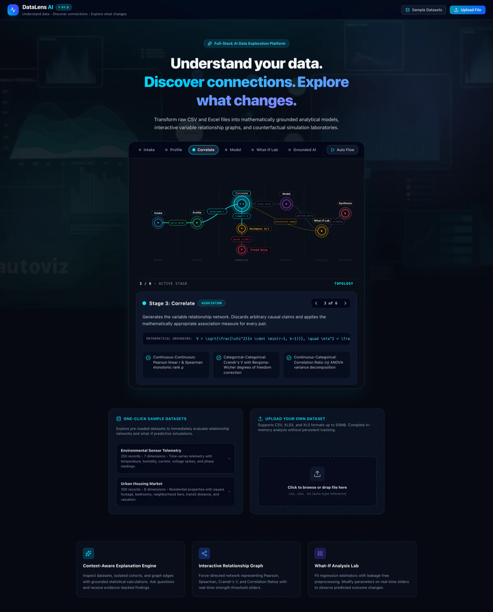
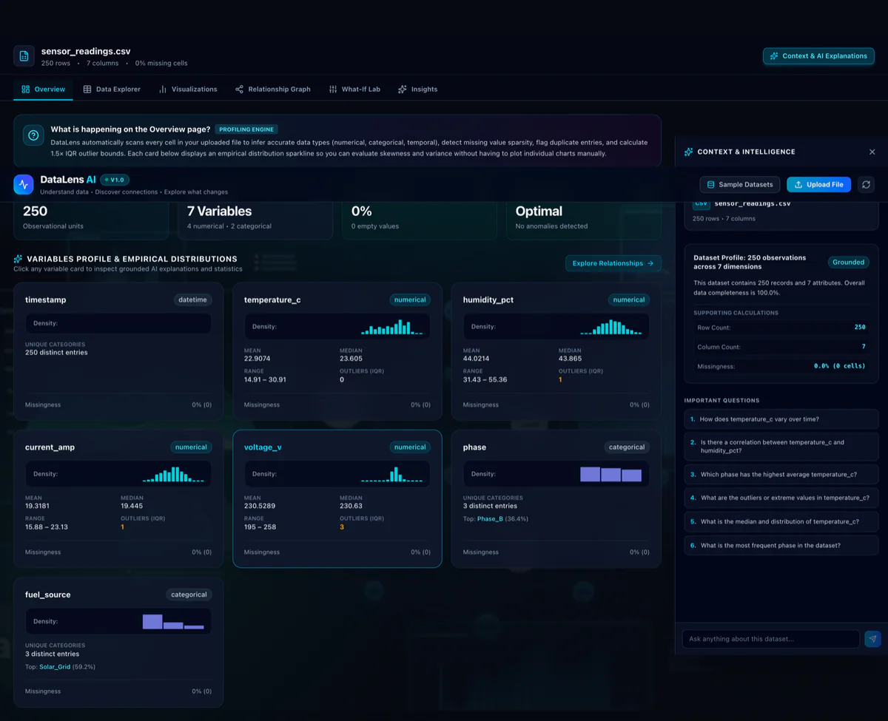
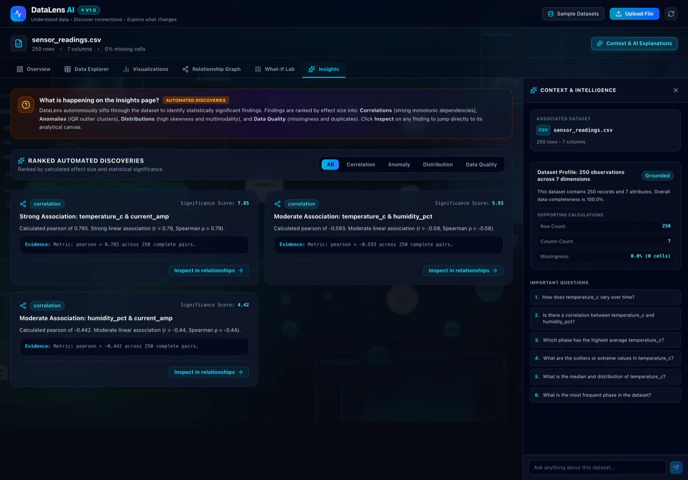
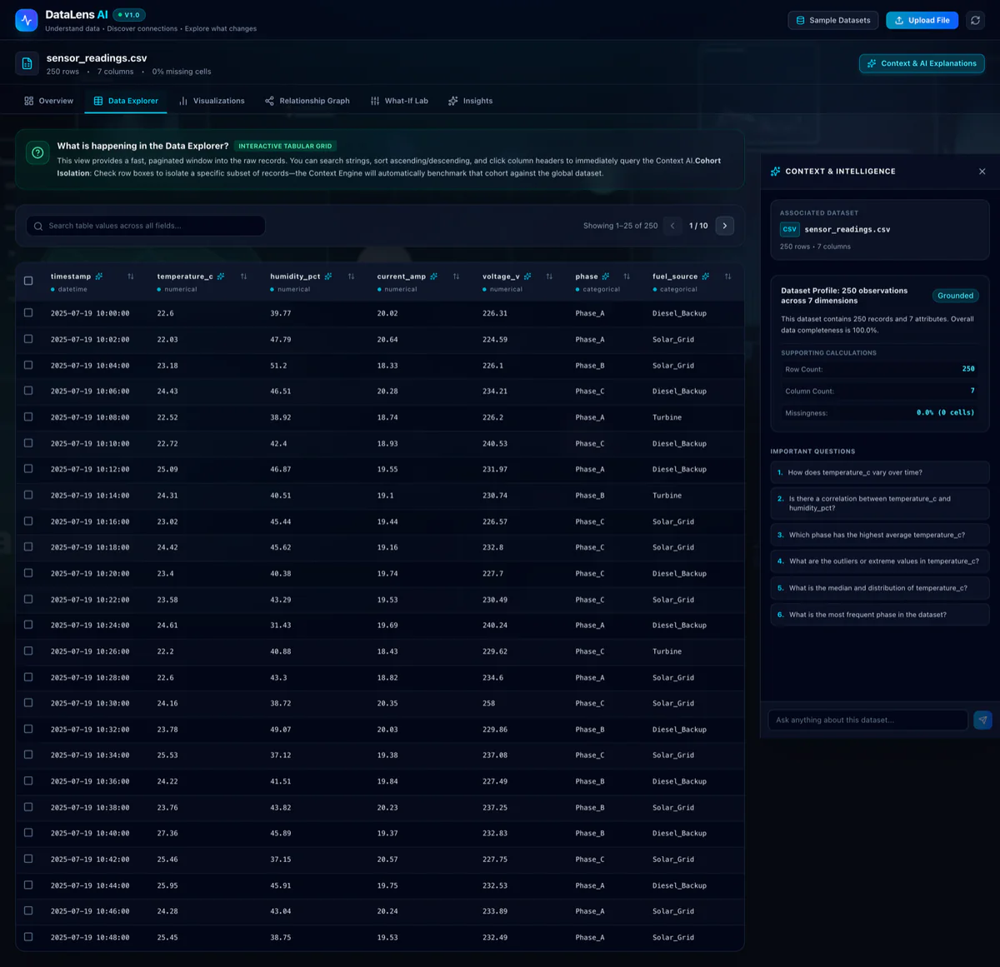
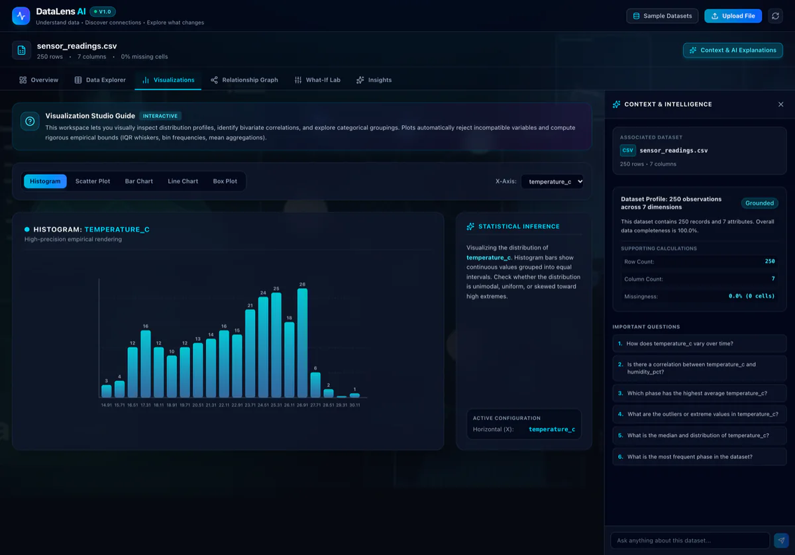
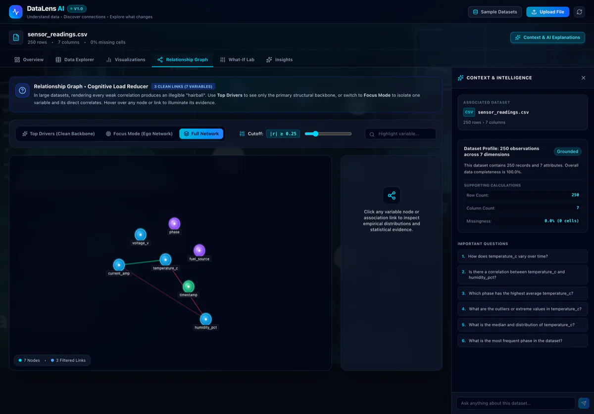
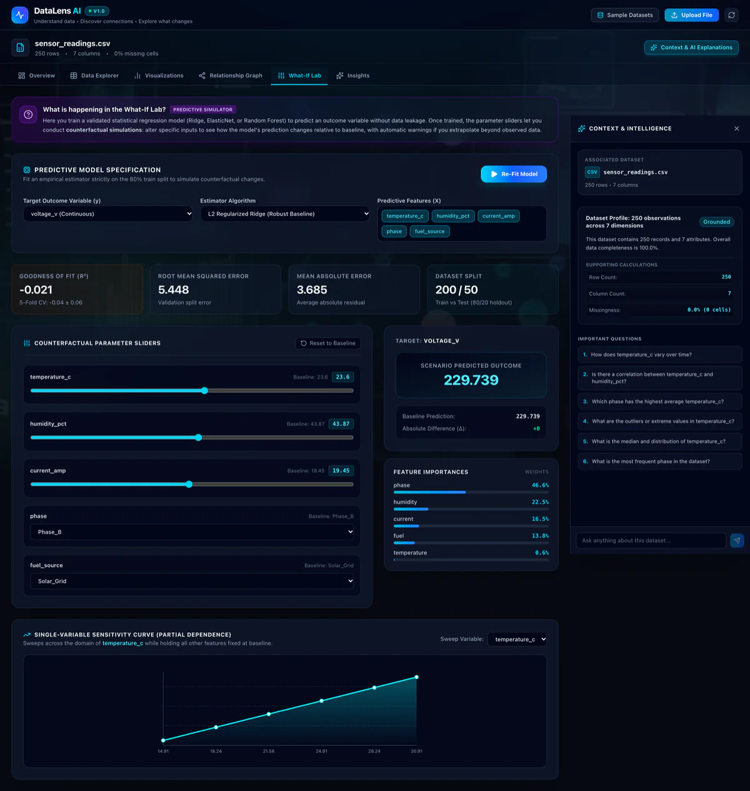
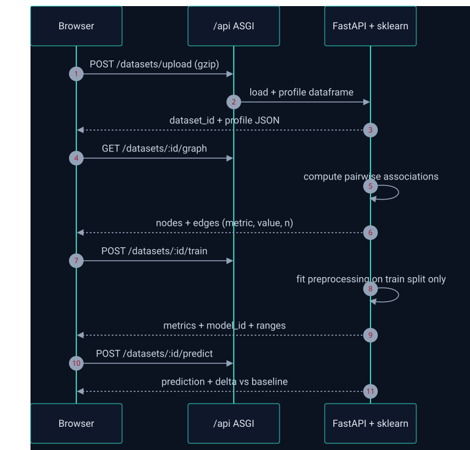

# DataLens AI

**Turn raw CSV / Excel files into grounded analytics — profiling, a variable-relationship graph, and a what‑if simulation lab.**

> ### 🧠 No external API calls. Ever.
> **Every number in DataLens AI is computed by our own Python engine on your machine — not fetched from someone else's model.** Correlations, distributions, regression coefficients and counterfactual predictions all come from in‑house `pandas` / `NumPy` / `SciPy` / `scikit-learn` math. The app runs **100% offline and deterministically**, and the optional LLM is *only* a phrasing layer that never invents a statistic. Pull the network cable out and the analysis still works.

> **Understand your data. Discover connections. Explore what changes.**

<p align="center">
  <a href="https://datalens-ai-beta.vercel.app" target="_blank" rel="noopener noreferrer">
    
  </a>
  <a href="https://github.com/AarushTumbagi/datalens-ai" target="_blank" rel="noopener noreferrer">
    
  </a>
</p>

<p align="center">
  <a href="https://vercel.com/new/clone?repository-url=https://github.com/AarushTumbagi/datalens-ai" target="_blank" rel="noopener noreferrer">
    
  </a>
</p>

---

## 🔗 Live Demo

<details open>
<summary><strong>▶ Click to toggle live demo details</strong></summary>

<br />

**Production URL:** [https://datalens-ai-beta.vercel.app](https://datalens-ai-beta.vercel.app)

<a href="https://datalens-ai-beta.vercel.app" target="_blank" rel="noopener noreferrer">
  
</a>

> The button above is a plain link with `target="_blank"` — clicking it opens the application in a **new browser tab / window**, leaving this repository page untouched.

| Resource | Link |
| --- | --- |
| 🌐 Web Application | https://datalens-ai-beta.vercel.app |
| ⚡ Backend Health Check | https://datalens-ai-beta.vercel.app/api/health |
| 📦 Repository | https://github.com/AarushTumbagi/datalens-ai |

</details>

---

## 📌 The Brief

Most "AI data" tools are a chat box bolted onto a black‑box API: you upload a spreadsheet, the numbers travel to a third‑party server, and a language model narrates statistics you can't verify. **DataLens AI does the opposite.** It treats statistics as the source of truth and language as a thin, optional veneer on top.

Upload a CSV or Excel file and DataLens AI will:

1. **Read it honestly** — validate the file, infer column types, and measure missingness/duplicates/outliers *without silently cleaning anything*.
2. **Quantify relationships** — pick the *mathematically correct* association measure per pair (Pearson *r*, Spearman *ρ*, Cramér's *V*, correlation ratio *η*) and draw them as an interactive network.
3. **Model what‑if** — fit a leakage‑free regression and let you move sliders to see how predictions change, with uncertainty and extrapolation warnings.
4. **Explain it in words** — grounded, evidence‑backed prose for whatever you select, generated deterministically from the computed results.

> **Catchphrase:** *No API calls required — the math is ours, the evidence is yours.*

---

## 📸 Screenshots

All captures below are of the **live production build** (`datalens-ai-beta.vercel.app`), loaded with the bundled *Environmental Sensor Telemetry* sample dataset.

### Landing & Analytical Pipeline


<table>
<tr>
<td width="50%">

**Overview — Profiling & Distributions**


</td>
<td width="50%">

**Insights — Ranked Discoveries**


</td>
</tr>
<tr>
<td width="50%">

**Data Explorer — Sortable Grid**


</td>
<td width="50%">

**Visualization Studio — Distributions**


</td>
</tr>
<tr>
<td width="50%">

**Relationship Graph — Measured Associations**


</td>
<td width="50%">

**What‑If Lab — Counterfactual Simulation**


</td>
</tr>
</table>

---

## 🧭 How It Works

### Analytical pipeline

<p align="center">
  
</p>

### Request lifecycle (serverless)

<p align="center">
  
</p>

### The one rule that keeps it trustworthy

<p align="center">
  
</p>

---

## 🌟 The Three Signature Features

### 1. Context-Aware Explanation Engine
- Understand any dataset, column, cohort, or relationship edge with grounded statistical commentary.
- **Zero-hallucination stance:** every claim traces back to a calculated metric (*r*, *ρ*, *η*, Cramér's *V*, IQR bounds, p-values).
- Interactive **Context Drawer** with pre-computed "Important Questions" pills, natural-language Q&A, and inline evidence tables.
- Works out of the box with **no LLM at all**; an optional provider only rephrases what was already computed.

### 2. Interactive Variable Relationship Graph
- Force-directed network of variables; edges are **measured associations**, not causal arrows.
- Per-pair measure selection: Pearson *r* / Spearman *ρ* (continuous), Cramér's *V* (categorical), Correlation Ratio *η* (continuous × categorical).
- Strength-threshold slider, variable search, **Top Drivers / Focus / Full Network** modes, and an edge drawer with pairwise scatter + trendline.
- Node inspection shows floating empirical distribution sparklines without leaving the canvas.

### 3. What-If Analysis Lab
- Choose a continuous outcome and features, fit **Ridge / ElasticNet / Random Forest**.
- **Leakage prevention:** imputation, scaling and one-hot encoding are fit strictly on the 80% train split.
- Validation with *R²*, RMSE, MAE and 5-fold cross-validated *R²*.
- Real-time sliders with baseline vs. updated predictions, absolute (*Δy*) and relative (*Δ%*) shifts.
- Single-variable **partial-dependence** sweeps plus out-of-distribution extrapolation warnings.

---

## 🏗️ Architecture

DataLens AI deploys the **React frontend and the FastAPI backend together from one repository** on Vercel.

- **Frontend** — root Vite app (React 19 + TypeScript + Tailwind v4) → static assets in `dist/`.
- **Backend** — `api/index.py` wraps the FastAPI app as a Vercel Python Serverless Function.
- **Routing** — `vercel.json` rewrites `/api/(.*)` to the function; the client uses relative `/api/...` paths (no CORS, no API keys in the browser).
- **Uploads** — the browser **gzip-streams** files over 100 KB (`CompressionStream('gzip')`), compressing text CSVs 75–85% to stay under the serverless body limit.
- **Storage** — ephemeral `/tmp/datalens_storage/`; in-memory dataset registry and cached model artifacts. No database, no accounts, no persistent tracking.

---

## 🛠️ Technology Stack

| Layer | Technologies |
| --- | --- |
| **Backend** | Python 3.11+, FastAPI, pandas, NumPy, SciPy, scikit-learn, openpyxl, Pydantic, pytest |
| **Frontend** | React 19, TypeScript, Vite, Tailwind CSS v4, Lucide Icons |
| **Deployment** | Vercel Serverless (ASGI), Docker & Docker Compose |
| **AI (optional)** | Any OpenAI-compatible endpoint via env vars — disabled by default |

---

## 🚀 Local Development Setup

### Prerequisites
- Python 3.10+
- Node.js 18+ and npm

### 1. Backend service

```bash
cd backend
python3 -m pip install -r requirements.txt
python3 -m uvicorn app.main:app --host 0.0.0.0 --port 8008 --reload
```

- Swagger API docs: `http://localhost:8008/docs`
- Health check: `http://localhost:8008/health`

### 2. Frontend service

```bash
# from the repository root
npm install
npm run dev
```

- Web application: `http://localhost:3000` (proxies `/api` to `http://127.0.0.1:8008`)

### 3. Or start both at once

```bash
./start.sh
```

---

## 🧪 Running Automated Tests

```bash
# Backend analytical test suites
cd backend
python3 -m pytest tests/test_backend.py -v

# Frontend production build verification
npm run build
```

The backend suites cover health checks, sample ingestion, statistical profiling & IQR outliers, relationship calculation & thresholds, leakage-free training, what-if prediction deltas, partial-dependence sweeps, grounded explanations/Q&A, and ranked insights.

---

## ☁️ Deployment (Vercel, single repo)

1. Push the repository to GitHub.
2. In the [Vercel dashboard](https://vercel.com/dashboard) choose **Add New → Project** and import the repo.
   - **Framework Preset:** Vite
   - **Root Directory:** `./`
   - **Build Command:** `npm run build`
   - **Output Directory:** `dist`
3. *(Optional)* Environment variables:
   - `OPENAI_API_KEY` — enables optional LLM rephrasing. **Not required.**
   - `APP_ENV` — `production`
4. **Deploy.** Vercel builds the Vite frontend and the Python function automatically.

Verify:

```bash
curl https://datalens-ai-beta.vercel.app/api/health
```

```json
{
  "status": "healthy",
  "service": "DataLens AI Analytical Backend",
  "version": "1.0.0",
  "runtime": "vercel-serverless",
  "storage": "/tmp/datalens_storage"
}
```

---

## 📂 Project Structure

```text
datalens-ai/
├── api/
│   ├── index.py                # Vercel Python serverless ASGI entrypoint
│   └── requirements.txt
├── backend/
│   ├── app/
│   │   ├── main.py             # FastAPI app + health routes
│   │   ├── core/               # config, errors
│   │   ├── samples/            # bundled sample datasets
│   │   ├── schemas/            # Pydantic models
│   │   ├── services/           # profiling, statistics, modeling, explanations, questions
│   │   └── api/routes/         # datasets, charts, relationships, explanations, insights, models
│   ├── tests/test_backend.py
│   └── requirements.txt
├── src/                        # React 19 + Vite frontend
│   ├── components/             # explorer, graph, what-if, drawers, common UI
│   ├── services/api.ts         # relative /api client with gzip uploader
│   └── types/api.ts
├── public/                     # autoviz_bg.webp (optimised background)
├── docs/
│   ├── screenshots/            # README captures (WebP, ~50–80 KB each)
│   └── diagrams/               # static SVG flowcharts used in this README
├── sample_data/
├── index.html
├── package.json
├── vite.config.ts
├── vercel.json
└── requirements.txt
```

---

## 🔒 Privacy & Limits

- Uploads are validated on the backend; file size, row counts and resource use are bounded.
- Dataset IDs are server-generated; no client filename is used as a storage path.
- **No dataset contents are logged**, and no full datasets are sent to any external service.
- Without an AI key configured, DataLens AI **never makes an outbound API call**.

---

## 📜 License

MIT License — free for open source and commercial use.
